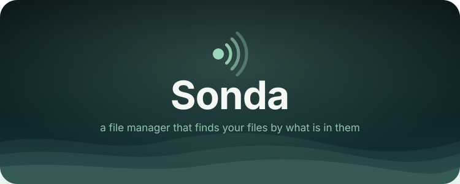
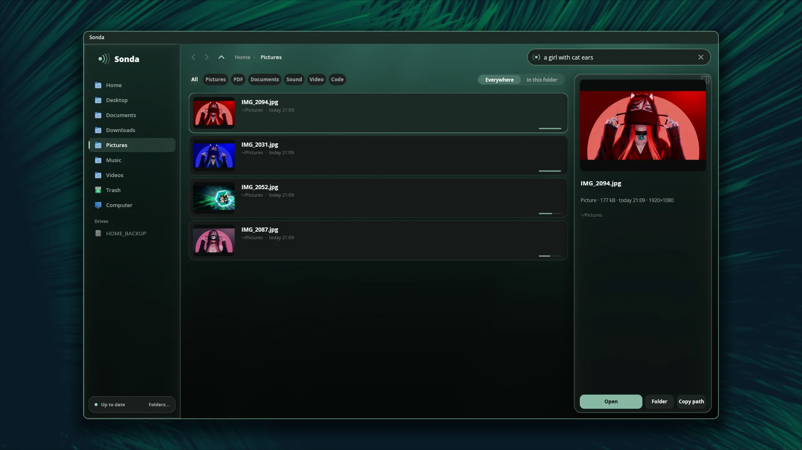
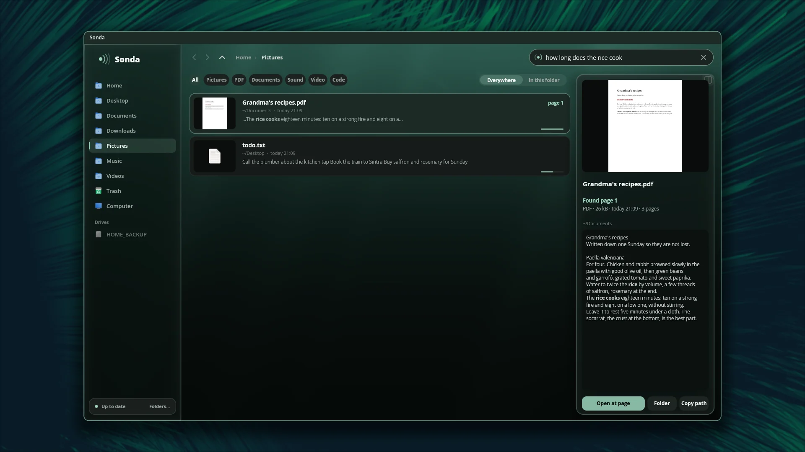
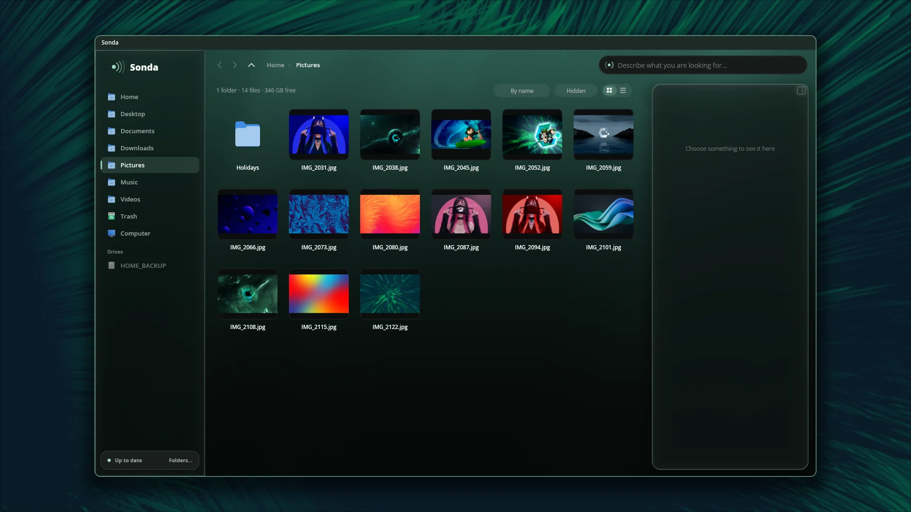

<div align = center>



<br>

[![Badge License]][License]
![Badge Language]
![Badge Commit]
[![Badge Issues]][Issues]
[![Badge Discord]][Discord]
[![Badge X]][X]
[![Badge Ko-fi]][Ko-fi]

<br>

Sonda is a file manager for [pleamar-wm] whose search knows what your files
hold: a photo by what it shows, a PDF at the page that says it, a recording at
the minute, a video at the moment, code at the line. Describe it in your own
words, in any language, and it digs it up. Everything runs on your computer.

<br>

---

**[<kbd> <br> Install <br> </kbd>][Install]**
**[<kbd> <br> What it reads <br> </kbd>][Reads]**
**[<kbd> <br> Keys <br> </kbd>][Keys]**
**[<kbd> <br> pleamar-wm <br> </kbd>][pleamar-wm]**
**[<kbd> <br> pleamar <br> </kbd>][pleamar]**
**[<kbd> <br> Discord <br> </kbd>][Discord]**

---

<br>

</div>

# What's new

- **A location bar**: Ctrl+L, or a press beside the crumbs, turns them into
  the whole path, to write another one. `~` is your home, a relative path goes
  from the folder shown, Tab finishes a folder's name, and a file's path opens
  its folder with that file chosen. It works in the Open/Save dialog too.
- **The reader waits for your videos**: while a browser or a video player is
  playing, it stops and lets go of the graphics card, so the video never
  stutters for it.
- **Narrow windows**: under 760 px the sidebar keeps only its icons, and the
  toolbar, the filters and the dialogs give up what does not fit.

Every change, in the [commits][Commits].

It is built on Google DeepMind's [EmbeddingGemma 2], the multimodal embedding
model released in October 2026, running on [llama.cpp] (on the graphics card
with Vulkan), and its window is a [pleamar] scene. The way it reads files and
ranks what it finds follows [DigUp] (MIT), which brought this model to macOS,
Windows and Linux first.

# Features

- **A file manager**: your places and your drives (a stick mounts when you
  press it and has an eject button), the folders as a grid of real thumbnails
  (photos, the first page of a PDF, a frame of a video) or as a list; back,
  forward, up, crumbs and a location bar to write a path in; copy, cut,
  paste, rename, new folder, the trash and restoring from it; files dragged
  out to any program, and dropped in from any program (onto the folder, a
  folder in it, a place, a crumb or a drive).
  - **Big copies say how far they are** and can be stopped halfway (nothing
    half-copied is left). On btrfs or xfs a copy is a reflink: instant.
  - **A name already taken** asks: replace, skip or keep both. What is
    replaced goes to the trash.
  - **Ctrl+Z undoes** the last copy, move, rename, new folder, trip to the
    trash, packing or unpacking.
  - **Open with…** any program, once or always for that kind of file.
  - **Properties**: size (a folder's, counted), dates, owner, who may read,
    write and run it (and changing it), and room left on the disk.
  - **Compress** to zip (or tar.gz, tar.xz, 7z… by the name you give) and
    **extract here** anything bsdtar reads: zip, rar, 7z, tar.*, iso.
  - A terminal in the folder.
- **A search by meaning and by words**. Type in the box: «the contract for the
  flat», «a dog on the beach», «where they talk about sleep». Exact words count
  too (invoice numbers, names, codes), as written in file names and in the
  text of documents. Filter by kind (pictures, PDF, documents, sound, video,
  code) and search everywhere or only in the folder you are in.
- **Found where it is**: each result says where —page 5, at 1:23, line 120—,
  and the look on the right shows that page, that frame, that stretch of text
  with your words in bold. «Open at page» opens the PDF there; a video or a
  recording **plays right there, inside the look**, from the moment found
  (ffplay inside Sonda's own compositor: pleamar-wm holds windows in windows).
- **Code**: start a search with `code:` and say what the code does
  («code: retry a failed call with backoff»). Your projects are read as git
  sees them (what it ignores is left out), never keys or password files.
- **Everything at once**: the reader runs in the background (`sonda daemon`),
  at the lowest priority, and a new file is searchable seconds after it lands.

<br>

<div align = center>

# Gallery

<br>



<sub>«a girl with cat ears»: pictures found by what they show, whatever their name.</sub>

<br>
<br>



<sub>«how long does the rice cook»: the page of the PDF that says it, with your words in bold.</sub>

<br>
<br>



<sub>A folder, with real thumbnails.</sub>

<br>
<br>

</div>

# Install

It needs pleamar-wm (or pleamar), ffmpeg, poppler (`pdftotext`, `pdftoppm`),
`gio` (the trash), `wl-copy`, `bsdtar` (libarchive: packing), `udisksctl`
(drives), and for the graphics card the Vulkan driver and `glslc` to build.

```sh
git clone https://github.com/k4ditano/sonda && cd sonda
sh scripts/build-llama.sh   # llama.cpp at the tag EmbeddingGemma 2 came with, with Vulkan (a while)
sh install.sh               # ~/.local/bin/sonda, its libraries, the models (865 MB), the window
```

`sonda setup` downloads the model the first time (ggml-org's 8-bit build: the
text part, 310 MB, and the picture and sound encoders, 555 MB). In
`~/.config/pleamar/keys.conf`:

```
bind Super+e  launch sonda
bind Super+s  launch sonda --search
```

and in `~/.config/pleamar/autostart`, so the index is always ready:

```
sonda daemon
```

# What it reads

The folders in `~/.config/sonda/config.json` (your Desktop, Documents,
Downloads, Pictures, Videos and Music at first; your Projects as code):

| | |
| --- | --- |
| pictures | PNG, JPEG, WebP, GIF, BMP, TIFF, by what they show (screenshots with more detail) |
| PDFs | page by page: the text of each page, and the page itself when it is a scan or a slide |
| documents | txt, md, html, docx, odt, rtf, in overlapping stretches |
| sound | any length, as overlapping 30-second windows (mp3, wav, flac, ogg, m4a, opus…) |
| video | a frame every few seconds (near-duplicates dropped), and its soundtrack as sound |
| code | stretches of whole lines, titled by their path in their project |

It never reads hidden folders, `node_modules`, build folders, keys,
certificates or password files. Inside a code project in your other folders it
reads only pictures and media.

# The desktop's file manager

`sonda setup` puts Sonda on the session bus, started when it is asked for:

- `org.freedesktop.FileManager1`: a browser's or a chat's **«Show in folder»**
  opens Sonda at that folder with the file chosen.
- `org.freedesktop.impl.portal.FileChooser`: the **«Open» and «Save» dialog**
  of every program that asks xdg-desktop-portal for one. It is Sonda's own
  window with a bar at the bottom —what will be given, the program's filters,
  the name to save with—, and its search works there too: «the electricity
  bill from March», and attach it. This one needs xdg-desktop-portal to know
  about it, once, as root. `install.sh` asks for it with sudo when you run it
at a terminal; otherwise:

  ```sh
  sudo install -Dm644 data/sonda.portal /usr/share/xdg-desktop-portal/portals/sonda.portal
  ```

  and, in `~/.config/xdg-desktop-portal/pleamar-portals.conf` (under
  `[preferred]`), `org.freedesktop.impl.portal.FileChooser=sonda`; then
  `systemctl --user restart xdg-desktop-portal`. Chrome and Electron programs
  use the portal by themselves; Firefox and Zen with
  `widget.use-xdg-desktop-portal.file-picker` set to 1; GTK programs with
  `GTK_USE_PORTAL=1`.
  Picking, the window is titled «Sonda · Elegir», so it can float over the
  program like a file dialog: in pleamar-wm's `session.conf`,
  `window title="Sonda · Elegir" float`.

To open folders with it: `xdg-mime default sonda.desktop inode/directory`.

# Keys

| | |
| --- | --- |
| `Super+E` · `Super+S` | Sonda · Sonda with the search ready |
| typing on a folder | starts a search |
| `↑ ↓ ← →` · `Enter` | move · open (a folder goes in) |
| `Alt+←` `Alt+→` `Alt+↑` · `Backspace` | back, forward, up · back |
| `Ctrl+C` `Ctrl+X` `Ctrl+V` | copy, cut, paste (other programs paste them as files) |
| `F2` · `Ctrl+Shift+N` · `Delete` | rename · new folder · to the trash |
| `Ctrl+L` | the location bar: write a path (`~` is home, `Tab` finishes a folder's name) |
| `Ctrl+H` · `Space` · `Ctrl+A` | hidden files · the look on and off · all |
| `Ctrl+Z` · `Alt+Enter` | undo · properties |
| `Esc` | leaves the search (picking for a program: cancels) |

# From the terminal

```sh
sonda search a receipt from the supermarket
sonda search code: where the window manager docks a window
sonda status          # how the reading goes
sonda pause · resume  # stop reading for a while
```

# How it works

```
your folders ─► readers: pictures, PDF pages (pdftotext, pdftoppm), documents,
                sound and frames (ffmpeg), stretches of code
             ─► EmbeddingGemma 2 on llama.cpp (Vulkan), through a small C layer
             ─► one SQLite file: a vector (768 halves) for every picture, page,
                stretch, frame and half minute of sound, and a keyword index (FTS5)
your words   ─► the same model's text part ─► every vector scored, put on one
                scale per query, plus the exact words ─► what stands out
```

The window is `ui/sonda.plm` (what is drawn and how it moves) and
`ui/sonda.luau` (its logic), which talks to `sonda bridge`, a JSON line each
way. Any agent can use it as a person would: `pleamar --say sonda describe`.

# Special Thanks

<br>

**[DigUp]** - *For bringing EmbeddingGemma 2 to the desktop first, and the way Sonda reads and ranks*

**[EmbeddingGemma 2]** - *For pictures, sound, video and words in one space*

**[llama.cpp]** - *For running it on any graphics card*

**[pleamar]** - *For everything that is painted*

# License

Sonda is under the [MIT License][License]. EmbeddingGemma 2 is Apache 2.0
(Google DeepMind); llama.cpp is MIT. The reading and ranking follow DigUp's
(MIT, Abdur Rahim). Sonda is not affiliated with Google. Gemma is a trademark
of Google LLC.

Contributions are welcome, made with AI or without it: see the [AI policy](AI_POLICY.md).

Made by **[@k4ditano][X]** — follow along on X for what comes next, and come
and say hi, ask or show what you made on **[Discord]**.
If it helps you find your things, you can **[buy me a coffee on Ko-fi][Ko-fi]** ☕

<!----------------------------------------------------------------------------->

[Install]: #install
[Reads]: #what-it-reads
[Keys]: #keys
[pleamar]: https://github.com/k4ditano/pleamar
[pleamar-wm]: https://github.com/k4ditano/pleamar-wm
[License]: LICENSE
[X]: https://x.com/k4ditano
[Discord]: https://discord.gg/N7kbYC49b2
[Ko-fi]: https://ko-fi.com/k4ditano
[Issues]: https://github.com/k4ditano/sonda/issues
[Commits]: https://github.com/k4ditano/sonda/commits/main

<!----------------------------------{ Thanks }--------------------------------->

[DigUp]: https://github.com/ARahim3/DigUp
[EmbeddingGemma 2]: https://huggingface.co/google/embeddinggemma-2
[llama.cpp]: https://github.com/ggml-org/llama.cpp

<!----------------------------------{ Badges }--------------------------------->

[Badge License]: https://img.shields.io/badge/license-MIT-9ed6bd?style=flat-square
[Badge Language]: https://img.shields.io/badge/made%20with-Rust%20%2B%20pleamar-2c7684?style=flat-square
[Badge Commit]: https://img.shields.io/github/last-commit/k4ditano/sonda?style=flat-square&color=9ed6bd
[Badge Issues]: https://img.shields.io/github/issues/k4ditano/sonda?style=flat-square&color=2c7684
[Badge Discord]: https://img.shields.io/badge/chat-Discord-5865f2?style=flat-square&logo=discord&logoColor=white
[Badge X]: https://img.shields.io/badge/follow-@k4ditano-000000?style=flat-square&logo=x
[Badge Ko-fi]: https://img.shields.io/badge/support-Ko--fi-ff5e5b?style=flat-square&logo=ko-fi&logoColor=white
